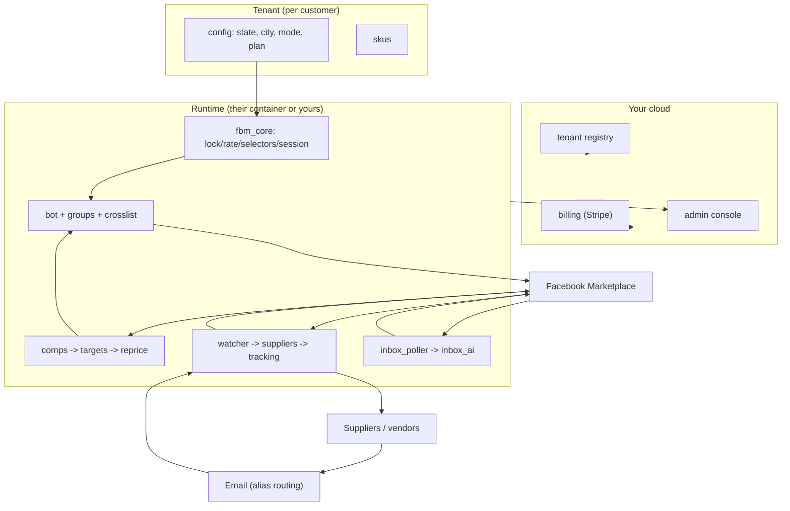

# Architecture

## Data flow

## Trust boundaries

- **Their data stays local** unless they enable cloud sync. The cloud only stores tenant/plan/billing + aggregate metrics.
- **Supplier keys** live in their `.env`. Ours never touch them.
- **Billing** is the only PII: email + Stripe customer id.

## Failure domains

| Domain | Blast radius | Mitigation |
|---|---|---|
| Profile lock | one tenant | per-tenant profile dirs |
| Rate limit | one account | per-account limiter state |
| Vendor outage | one SKU | backup supplier |
| FB suspension | one account | multi-account routing |
| Billing failure | dashboard only | listings keep running |